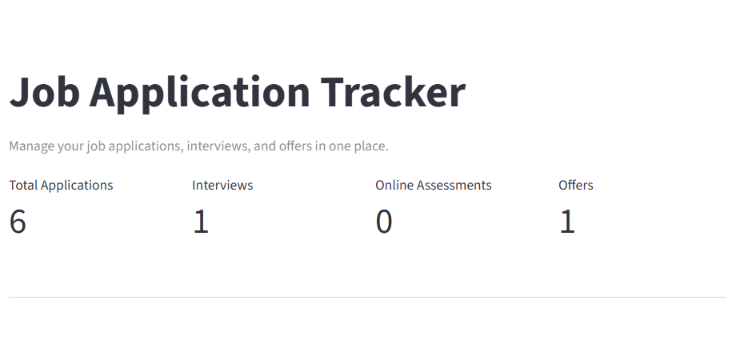
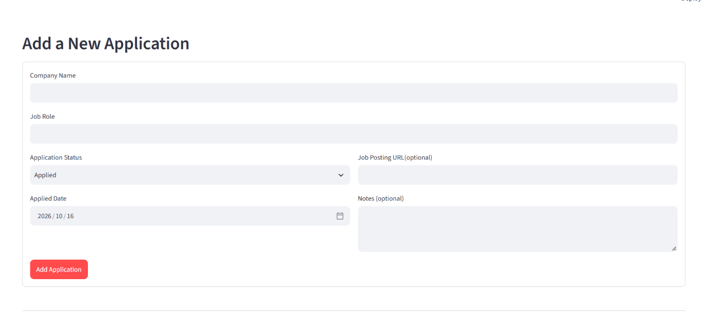
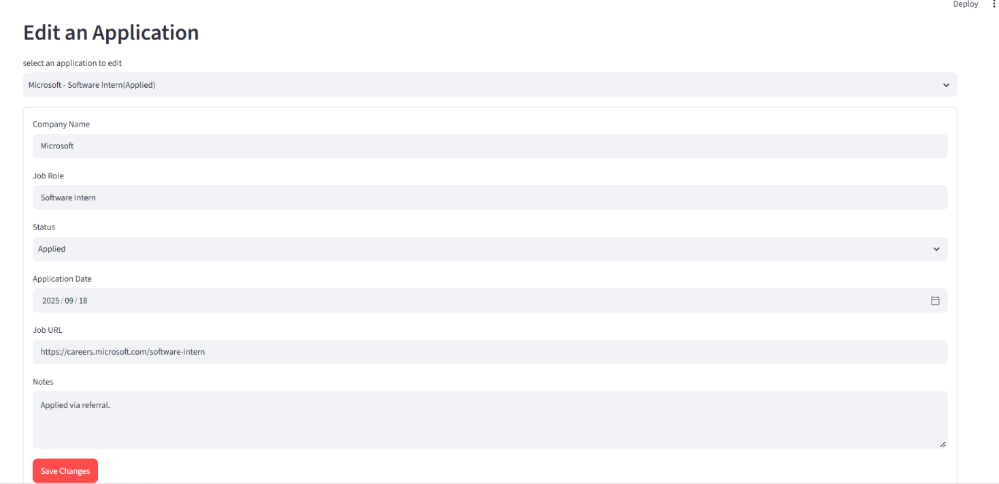
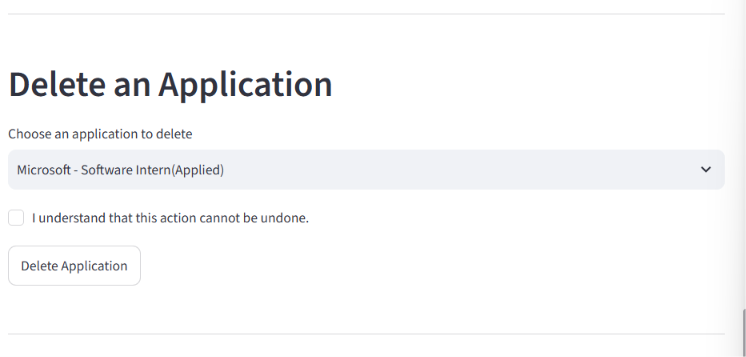
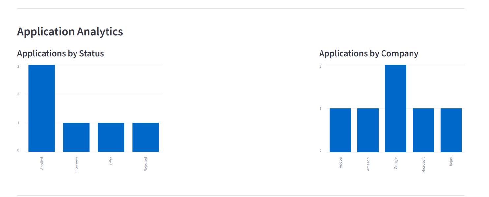
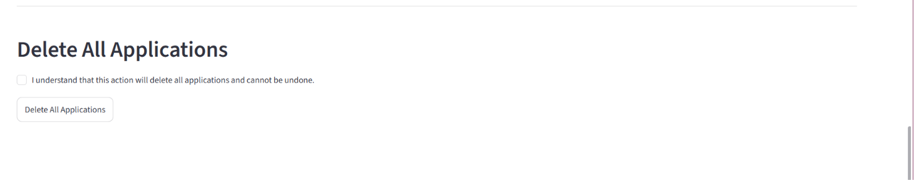

# Job Application Tracker

A Python-based application for managing job applications, tracking hiring progress, and analyzing application statistics using MongoDB.

## Features

- Add, view, update, and delete job applications.
- Search applications by company name or job role.
- Filter applications by status.
- Validate application data in Python and MongoDB.
- Generate application statistics using MongoDB aggregation pipelines.
- Visualize application and company summaries in an interactive Streamlit dashboard.

## Technology Stack

- Python
- MongoDB Atlas
- PyMongo
- Streamlit
- Pandas

## Database Design

**Database:** `job_tracker`

**Collection:** `applications`

Each document contains company name, job role, application status, application date, job URL, and notes. MongoDB automatically generates a unique `_id` for each document.

## Installation

1. Clone the repository.
2. Create and activate a Python virtual environment.
3. Install dependencies:

   `pip install pymongo "pymongo[srv]" streamlit dnspython python-dotenv pandas`

4. Create a `.env` file and configure your MongoDB Atlas connection string:

   `MONGODB_URI=your_mongodb_connection_string`

5. Configure database validation:

   `python setup_validation.py`

6. Run the dashboard:

   `streamlit run app.py`

## Testing

Run the CRUD tests:

`python test_crud.py`

Run the aggregation tests:

`python test_aggregation.py`

Run the MongoDB validation test:

`python test_validation.py`

## Learning Outcomes

This project demonstrates document-oriented database design, Python–MongoDB integration, data validation, CRUD operations, and aggregation pipelines.

## Security

Database credentials are stored in environment variables and must not be committed to version control.

